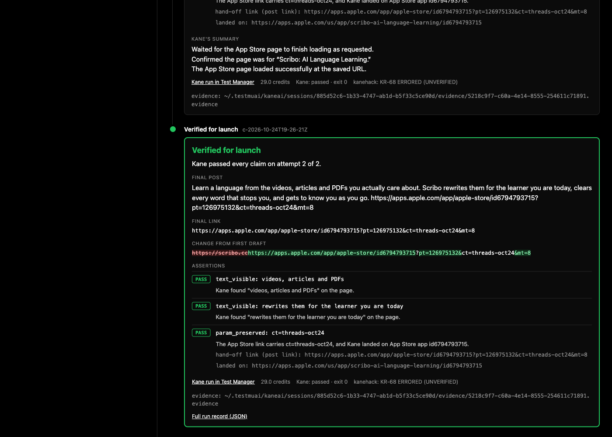
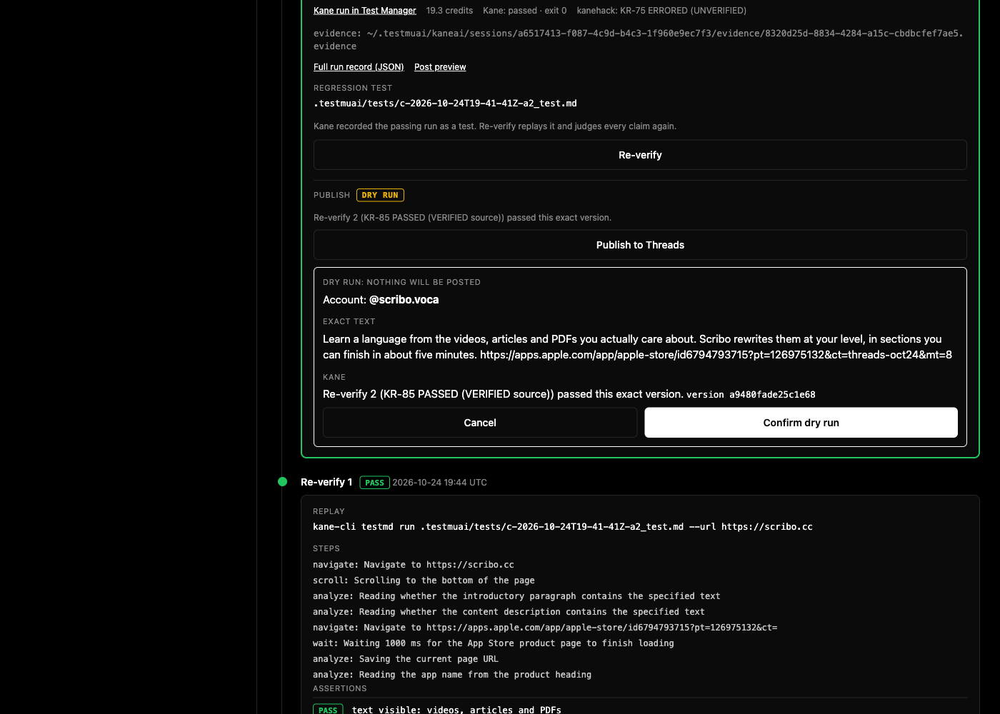
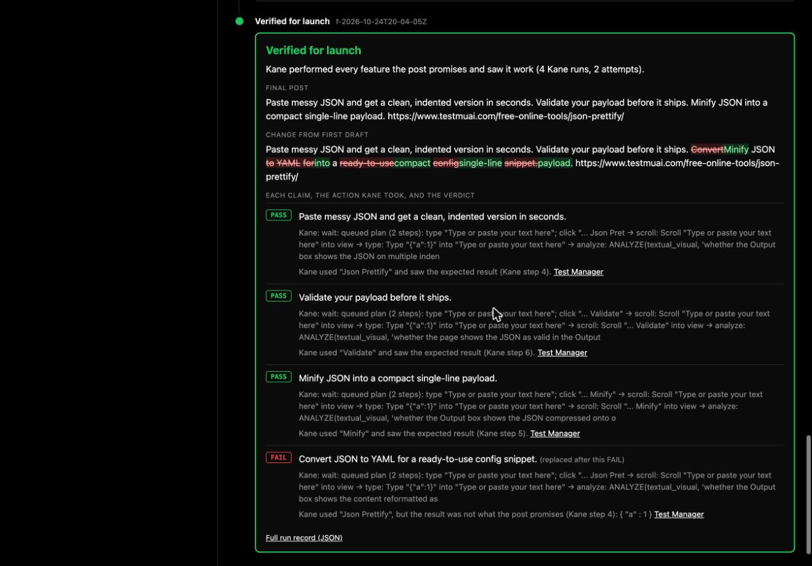
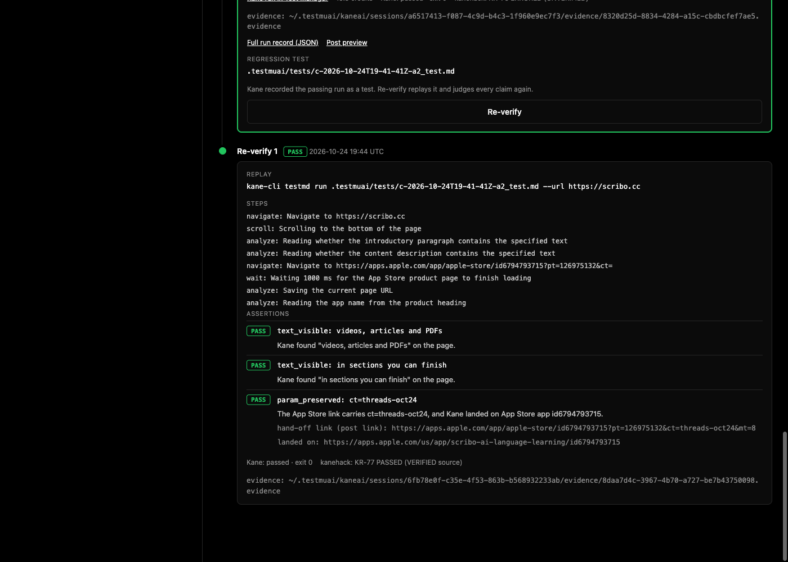

# Omni Verify

> **Recorder proof:** Kane run **KR-46** was logged by the kanehack recorder as **PASSED (VERIFIED source)**: Kane's own designed tests for the campaign, 2/2 passed ([proof tab](https://kaneclihack.sh/t/omni/proof#run-46)). **KR-77**, a Re-verify replay of a verified campaign, is also PASSED (VERIFIED source) ([proof tab](https://kaneclihack.sh/t/omni/proof#run-77)). Every other run is listed in [RUNS.md](RUNS.md) (why most show ERRORED: see *Known limits*).

**What it is:** a launch gate for AI-written growth campaigns. An OpenAI agent drafts the post, every claim in it becomes an assertion, Kane walks the real funnel in a browser, and only campaigns Kane passes are marked *Verified for launch*.
**Who it's for:** solo founders and small teams who let an agent write and post their marketing, and need to know the link and the copy hold up before it goes out.



## Run it

```
bun install && bun run dev
# open http://localhost:3000 (PORT=3001 bun run dev for another port)
```

You need:
- `.env` with `OPENAI_API_KEY` and `OPENAI_MODEL` (we use `gpt-5.4-mini`, picked by timing the models this key can list).
- `kane-cli` (0.10.0-rc.3) signed in, and `kanehack` paired. Every Kane call goes through `kanehack report -- kane-cli …`.
- Optional, once per app: `bun run explore https://your.app` maps the site with Kane Explore into `explore/<host>.json`; drafts for that app are grounded in the map. scribo.cc is already mapped.

`bun test` runs the parser and evaluator tests against real Kane output saved in `fixtures/` (no credits).

The left panel also lists recorded runs. Clicking one replays it on the same timeline without spending credits, labeled as recorded.

## Publish to Threads (gated)

A Verified card has a **Publish to Threads** button. It stays locked unless the latest Kane result (the last attempt, or the last Re-verify) is a PASS for this exact campaign version (a hash of the copy, link and claims), and the campaign isn't already published. Publishing takes a click and then a confirm that shows the Threads account, the exact text and the Kane result it rests on; the server checks the gate again and needs the confirmed version.

- `PUBLISH_MODE` defaults to dry run: the confirm checks the Threads account and records the attempt, and nothing is posted. Set `PUBLISH_MODE=live` in `.env` (and restart) to post for real.
- Posting goes through the existing Hermes script, `~/.hermes/scripts/threads_api.py`, with `THREADS_PROFILE` (default `scribo`, i.e. @scribo.voca; `default` uses the script's default token file). The script reads its own token file; Omni Verify never reads or stores a token.
- The published post URL is stored with the campaign (`runs/c-*.json`, `published`) and shown on the card.



## The Scribo finding

Scribo (https://scribo.cc) is my own app. Every App Store button on the site has a hard-coded tracking tag (`ct=site-en-hero`, `ct=site-en-nav`, `ct=site-en-get`), and the site never reads the incoming URL's query. So a Threads post that links to `https://scribo.cc?ct=threads-oct24` loses its tag at the button, and App Store Connect credits the install to "site-en-hero". Attribution breaks silently: the post looks right, the click works, the numbers are wrong.

The demo loop, from the UI ([runs/c-2026-10-24T19-26-21Z.json](runs/c-2026-10-24T19-26-21Z.json), 136 s):

| Step | What happened | Kane run |
|---|---|---|
| Draft | Post links to `https://scribo.cc?ct=threads-oct24`; 3 claims: 2 sentences of copy + the tracking tag | |
| Kane run 1 | Both sentences found on the page. Kane read the main button's href before clicking: `…id6794793715?pt=126975132&ct=site-en-hero&mt=8`. **FAIL**: the campaign's `ct=threads-oct24` does not survive | KR-63, [Test Manager](https://test-manager.lambdatest.com/projects/01M5QFK845A9PX95YRENJ1Z5XD/test-cases/01M5QP1RZHNANDSEXFRY6C9Z7M/dashboard/share/US_GPOSCOJ2Z418IO7OGMH1KH6TR2IXO2SKCOXW66KSUZYJYLCPBQW52485M5N2ZDO0?type=summary&agentView=true&fqdn=summary-page) |
| Repair | The agent read Kane's href and rebuilt the link from it: same App Store URL, `pt` and `mt` kept, `ct` set to `threads-oct24` | |
| Kane run 2 | Both sentences found again; the post's link carries `ct=threads-oct24` and Kane landed on App Store id6794793715. **PASS** | KR-68, [Test Manager](https://test-manager.lambdatest.com/projects/01M5QFK845A9PX95YRENJ1Z5XD/test-cases/01M5QP451DD362PS3ZW4HCGJ55/dashboard/share/US_KR6UIN4XDB3ZU6MU0POJLNS9UYGZL7NOZBRA2O1XL4JAWH1R0DL9HSEBAJW5H04K?type=summary&agentView=true&fqdn=summary-page) |
| Result | Verified for launch, with a diff from the first draft | |

The same FAIL → repair → PASS happened in all five full loops run today (`runs/c-*.json`). The first FAIL, before the loop existed, is KR-6 ([Test Manager](https://test-manager.lambdatest.com/projects/01M5QFK845A9PX95YRENJ1Z5XD/test-cases/01M5QK5M9707JQ3YX2CWYYZ8EN/dashboard/share/US_RF1K5D2V9Z8KPC0WAXSIIS7W2T716SQC05TIKB5MBAQ8J7U9N6R4LVW6M3YO6BUU?type=summary&agentView=true&fqdn=summary-page)).

## How the agent and Kane talk

```
input (app URL, goal, audience)
  → draft (OpenAI, structured JSON, grounded in the Kane Explore map + page text)
      post_copy, cta_url (with ct=), claims[] → assertions
  → compile: all assertions → one plain-English Kane objective
  → kanehack report -- kane-cli run "<objective>" --url … --agent --headless --assertion-failure-mode continue --name <campaign>-a<n>
  → parse NDJSON: steps stream to the page over SSE; verdicts come from run_end (context.memory)
  → PASS: Verified for launch
    FAIL / UNVERIFIED: repair (OpenAI) gets the failing assertions + what Kane saw + Kane's summary,
                       returns a revised campaign + one-line reason → Kane again (max 3 attempts)
  → Re-verify (button on the Verified card):
      kanehack report -- kane-cli testmd run .testmuai/tests/<campaign>-a<n>_test.md --url … --agent --headless
      replays Kane's own recording of the passing attempt; the values its checks stored are read from the
      replay's evidence pack and judged by the same evaluator
```

- **Kane extracts, the code judges.** The objective asks Kane to *store* what it sees (the button's href, the landing URL, true/false per sentence). The evaluator compares those values to the assertions, so the verdict is the same check on every run and cites the Kane step it came from.
- **Two assertion types.** `param_preserved`: the link that hands the visitor to the App Store carries the campaign's own `ct`. `text_visible`: each sentence of the post is backed by a phrase Kane finds on the app's page. A draft that leaves any sentence without a claim is rejected before Kane runs.
- **Repairs are constrained.** The agent may fix the link (only from URLs Kane observed), or rewrite/drop a sentence Kane didn't find. It may not change the campaign tag or drop the attribution claim, and every repair is re-validated. In a dry run the model first copied Kane's href verbatim (still `site-en-hero`); the validator rejected it, and the agent gets one retry with the reason.
- **No Kane result means no PASS.** A missing `run_end` or a value Kane didn't report is UNVERIFIED, which is never treated as a pass.
- The commit history records each time a Kane result changed what the agent or the design did.

## Kane features used

| Feature | How | Evidence |
|---|---|---|
| `kane-cli run --agent` | Every verification attempt; NDJSON parsed live | `runs/`, `fixtures/kane-sample.ndjson` (Step 0 schema) |
| `kane-cli explore` | Read-only local exploration of scribo.cc, 12 leases: 7 screens, 7 flows verified, 20 findings (mostly accessibility). Showed every App Store button links to `apps.apple.com/app/apple-store/{slug}?ct&mt&pt`, i.e. sets its own `ct` | `explore/scribo.cc.json`, `explore/scribo.cc.ndjson`, `explore/scribo.cc-steps/` |
| Assurance loop | The verified campaign became a requirement (`requirements/campaign-threads-oct24.md`). `context ingest` → use case → owner review → `design tests` (5 criteria, 3 scenarios, 2 tests, 2 gaps) → owner review → `maintain evolve` → `testrun run` (2/2 passed, **KR-46**) → `cover` | `evidence/assurance/`, `.testmuai/tests/` |
| Coverage | **75%**: 3 of 4 criteria proven by real runs | `evidence/assurance/11-cover.ndjson` |
| `--name` + `testmd run` replay | Every attempt is a named run, so Kane records it as a `_test.md`. The passing one is the campaign's regression test; **Re-verify** replays it (about 10 s, no authoring) and re-judges every claim from the values the replay computed. First replay: all 3 claims PASS, **KR-77 PASSED (VERIFIED source)** | `.testmuai/tests/c-*_test.md`, `runs/*-rv*.json`, `docs/reverify.png` |

**Why 25% is unmeasurable.** The fourth criterion is "installs from the Threads post are credited to threads-oct24". Kane itself recorded it as an *unmeasurable* gap: install credit shows up in App Store Connect, not in any page a browser can open. What Kane can prove is that the hand-off link carries the right `ct`.

**Owner decisions in the loop.** Kane proposed a criterion "the App Store hand-off retains ct after opening". The App Store strips the query string from the address bar after load (Step 0: Kane's final URL has no query), so it can't be observed. It was rejected and archived with that reason, and `maintain evolve` had Kane supersede the test that asserted it (t-1 → t-3). Two `design --force` runs before that answered `nothing_to_change`; the archive was what made the redesign happen.

## Kane false negative, and the workaround

The build brief said scribo.cc shows "Try Pro free for 7 days" in the pricing section, below the fold. It does: `<b>Try Pro free for 7 days</b>` is in the HTML. Asking Kane different ways (all real runs, saved in `fixtures/`):

| Phrasing | Result |
|---|---|
| "Verify the text 'Try Pro free for 7 days' is visible" (KR-51) | **FAIL**, a false negative: Kane's generated check read the wrong element |
| Scroll first, then verify (KR-54) | Trial PASS, but the run got stuck on an absent price and never judged the third check |
| `--analyzer-only --condition …` (KR-55) | `[null, false, true]`: null on the below-fold trial |
| "Scroll down once, then store whether the text '…' appears as 'claim_n'" (KR-58) | true / false / true, all correct, no stuck run |

Omni Verify compiles to the last phrasing. Trusting the first one would have made the repair agent delete a true sentence.

## Feature claims: verified by doing, not by reading

Text checks prove a sentence is on a page, not that the feature works. For posts about a tool, every sentence that promises a feature is performed by Kane in real Chrome. Target: TestMu AI's free online tools ([JSON Prettify](https://www.testmuai.com/free-online-tools/json-prettify/)). UI at `/features.html`.

```
tool URL → page text (the tool's own section) → OpenAI drafts the post; per sentence: control, action (exact sample input), expected result
  → one Kane run per claim: store whether the control exists, do the action only if it does, store the result and whether it matches
  → code judges: control missing or result wrong = FAIL, nothing stored = UNVERIFIED (re-run unchanged), both true = PASS
  → FAIL: the agent rewrites or drops that sentence (passing ones must stay word for word) → Kane runs only the new claim
```

Stretch mode (on by default in the UI, labeled) tells the agent to add one format conversion the page doesn't show, so the gate has a false promise to catch.

| Run | What happened |
|---|---|
| [f-…20-04-05Z](runs/f-2026-10-24T20-04-05Z.json) | Prettify PASS (KR-96), Validate PASS (KR-98, Kane read "Valid!"), "Convert JSON to YAML" **FAIL** (KR-100, [Test Manager](https://test-manager.lambdatest.com/projects/01M5QFK845A9PX95YRENJ1Z5XD/test-cases/01M5QRBFX0BJXG4V4JYZVHQM3N/dashboard/share/US_RDFEH67SSMMI8JO4N493GGU00O4QNXW9AJB7RF7D291L4L9J6WXAYDGMW0L7FBLY?type=summary&agentView=true&fqdn=summary-page)): Kane clicked the button, the output was still JSON. The agent swapped in Minify → **PASS** (KR-102, [Test Manager](https://test-manager.lambdatest.com/projects/01M5QFK845A9PX95YRENJ1Z5XD/test-cases/01M5QRDYF3BHW7BMNFSJ2GPBF3/dashboard/share/US_7N4JXFZ9OXIPVA0ZLOSANVRAC52QK72L7H1XEE51DZ52LON0HF4U4CM7JKNHYVXE?type=summary&agentView=true&fqdn=summary-page)). Verified for launch. |
| [f-…19-53-00Z](runs/f-2026-10-24T19-53-00Z.json) | "Converts the same input into CSV" **FAIL**: Kane found no CSV control (KR-90). The two true claims came back UNVERIFIED: an "if it does not exist, stop" branch made Kane stop before storing the result. The branch was removed, and the run stopped because the repair was asked to rewrite UNVERIFIED sentences too. Now only FAILs go to repair. |
| [f-…19-58-22Z](runs/f-2026-10-24T19-58-22Z.json) | Validate UNVERIFIED (KR-93), re-run unchanged → PASS (KR-95). Its stretch sentence ("Clear the field…") was a real feature. Its KR-94 PASS stored "none" as the result. That now counts as UNVERIFIED, and the stretch prompt now asks for a format conversion. |

Seen on the real tool: JSON Prettify's tab-indented output puts spaces around colons (`"a" : 1`). Kane's output is in each run file.



## Known limits

- **Phrase-level backing.** A sentence is backed by a 3–12 word phrase copied from the page. The phrase can prove only part of a longer sentence (in the demo run, "rewrites them for the learner you are today" backs a longer sentence that is on the page in full, but the check covers only the phrase).
- **It stops at the App Store.** Kane checks the link and that it lands on the right listing. It does not install the app or follow the funnel inside it.
- **Verification is not measurement.** A PASS means the funnel keeps the post's promises today. It does not mean installs went up, or that App Store Connect credited them (see the unmeasurable 25%).
- **Recorder bug H-0007.** kane-cli 0.10.0-rc.3 sends a `coverage` event before `run_end`, so the kanehack recorder never sees `run_end` as the completion event and marks passing `kane-cli run` calls as ERRORED (UNVERIFIED). Reported as help ticket H-0007. Our own record of every run (time, Kane's own status, credits, Test Manager link) is in [RUNS.md](RUNS.md). `testrun` is unaffected: KR-46 shows PASSED.
- **Pre-launch post.** Nothing is published before the gate passes, so Kane's designed tests open `/post/<id>`, a preview page Omni Verify serves, labeled "not published".
- **Re-verify has not caught a regression yet.** The replays so far passed; the checks are re-computed during the replay (their timestamps in the pack are the replay's), but a FAIL needs the site to change. A replay whose recordings no longer match the page heals by re-authoring, which costs more and is slower.
- The test files of failed attempts stay in `.testmuai/tests/` too (Kane writes every named run); only the passing one is linked as the regression test.
- Scope: one app (Scribo), one channel, App Store links only. Feature claims: tested on one TestMu AI tool (JSON Prettify).
- **Feature claims trust Kane's true/false.** The code judges from Kane's stored values, and "does the result match" is Kane's own judgment (the result text is kept next to it). A stretch claim may name an existing control (the YAML claim used Json Prettify), so it fails on a wrong result instead of a missing control.

## Screenshots

- [docs/verified-card.png](docs/verified-card.png): the Verified card with every assertion and the diff from the first draft.
- [docs/live-run.png](docs/live-run.png): the whole timeline of the demo run: draft, Kane run 1 FAIL, repair, Kane run 2 PASS, verdict.
- [docs/reverify.png](docs/reverify.png): Re-verify replaying Kane's saved test and re-judging the claims.



## Evidence

| What | Where |
|---|---|
| Every Kane run: time, recorder label, Kane status, credits, Test Manager link | [RUNS.md](RUNS.md) |
| Each campaign run: drafts, objectives, verdicts, repairs | `runs/c-*.json` (+ raw Kane NDJSON per attempt in `runs/*.ndjson`) |
| Sealed Kane evidence packs, unedited (they are sealed, so they keep local paths) | `evidence/loop/` (demo run, FAIL and PASS), `evidence/assurance/packs/` (KR-46). View with `kane-cli evidence serve <pack>` |
| Assurance loop streams, verdict files, designed tests (before/after evolve), coverage | `evidence/assurance/` |
| Kane Explore map and stream | `explore/` |
| Real Kane output used by the tests | `fixtures/` |

Built at Kane CLI Hack Day, 2026-10-24.
