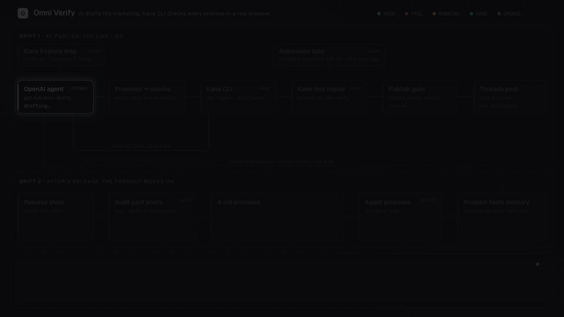
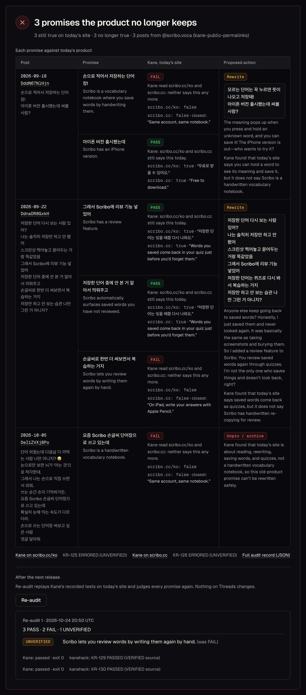

# Omni Verify

**My AI agent writes my marketing. Kane CLI proves every promise in it is true before it ships, and again after every release.**

[](https://www.kaneclihack.sh/ship/omni)
[](#run-it)
[](#kane-features-used)
[](https://bun.sh)
[](#run-it)

**[Demo video](https://www.loom.com/share/428499f73e57490c818743d7e2de3d77)** · **[Ship page](https://www.kaneclihack.sh/ship/omni)** · **[Deck](https://www.kaneclihack.sh/ship/omni/deck)** · **[Blog](https://dev.to/daino0416/my-ai-agent-writes-my-marketing-today-i-made-it-prove-every-post-is-true-199g)** · **[Live post](https://www.threads.com/@scribo.voca/post/De4-yPnATF5)**

[](docs/architecture.html)

<sub>The architecture as a motion graphic: [docs/architecture.html](docs/architecture.html) (open it in a browser, or at `/architecture.html` in the running app), [MP4](docs/architecture.mp4), [still](docs/architecture.png).</sub>

> **Submission:** finalized at commit [`1800ca4`](https://github.com/DainoJung/omni-verify/commit/1800ca455c53d8aa663b5f450bb00889acf94ceb) (receipt S-PVWT). Later commits are docs and visual polish only: no change to the product logic or the recorded runs.

**The problem:** marketing promises and the real product drift apart silently. AI growth agents make it worse: they write promises at scale, and they learn from the numbers those promises produce.

**Who:** solo founders who let an AI agent write and post their marketing, and judge what works from tracking tags.

**When it breaks:**
- **At publish time, the link lies.** Every App Store button on my app's site, scribo.cc, overwrites the campaign tag with `ct=site-en-hero`. Every install from my Threads posts would have been credited to the website. No error, just a wrong number, and my agent would have concluded Threads doesn't work and stopped posting there.
- **After every release, the product moves on.** Scribo 2.0 (October 1) turned a handwriting vocabulary app into a content learning app. Old @scribo.voca posts still promise a handwriting vocabulary notebook and keep bringing people in, who then find a different product and may leave.

**The fix:** the agent drafts a post and turns every promise in it into a check. Kane CLI checks each one in a real browser before the post ships (the link's tag, every sentence against the page, every promised feature), and again after every release (Re-verify for campaigns, Audit past posts for old posts). Failed promises are repaired from what Kane saw. Only a campaign that passes can publish.

**Proof:**

| What | Kane runs | Result |
|---|---|---|
| A real post went out through the gate: [@scribo.voca/post/De4-yPnATF5](https://www.threads.com/@scribo.voca/post/De4-yPnATF5) | Re-verify **KR-85** | The button unlocked only because KR-85 passed that exact version (`a9480fade25c1e68`) |
| The link lie, caught: Kane read `ct=site-en-hero` on the button | **KR-63** FAIL, then **KR-68** PASS | The agent rebuilt the link from the URL Kane saw. The same in all five full loops |
| Old posts against today's site | **KR-125**, **KR-126** | 3 of 6 old promises FAIL; 3 retired promises in the agent's memory |
| Recorded by kanehack as PASSED (VERIFIED source) | **KR-46** (Kane-designed tests, 2/2), **KR-77** and **KR-85** (Re-verify) | Every run is in [RUNS.md](RUNS.md) |
| Supporting example: feature claims on TestMu AI's free JSON tool. I seeded a false "convert JSON to YAML" claim to show the repair | **KR-100** FAIL, then **KR-102** PASS | The agent swapped in Minify |

Before my agent learns from a post, Kane proves the funnel tells the truth.

<table>
<tr>
<td width="50%"><br><sub>Verified for launch: every assertion, and the diff from the first draft.</sub></td>
<td width="50%"><br><sub>Audit past posts: today's site against @scribo.voca's old promises.</sub></td>
</tr>
</table>

## Run it

```
bun install && bun run dev
# open http://localhost:3000 (PORT=3001 bun run dev for another port)
```

You need:
- `.env` with `OPENAI_API_KEY` and `OPENAI_MODEL` (I use `gpt-5.4-mini`, picked by timing the models this key can list).
- `kane-cli` (0.10.0-rc.3) signed in, and `kanehack` paired. Every Kane call goes through `kanehack report -- kane-cli …`.
- Optional, once per app: `bun run explore https://your.app` maps the site with Kane Explore into `explore/<host>.json`; drafts for that app are grounded in the map. scribo.cc is already mapped.

`bun test` runs the parser and evaluator tests against real Kane output saved in `fixtures/` (no credits).

The left panel also lists recorded runs. Clicking one replays it on the same timeline without spending credits, labeled as recorded.

## Publish to Threads (gated)

A Verified card has a **Publish to Threads** button. It stays locked unless the latest Kane result (the last attempt, or the last Re-verify) is a PASS for this exact campaign version (a hash of the copy, link and claims), and the campaign isn't already published. Publishing takes a click and then a confirm that shows the Threads account, the exact text and the Kane result it rests on; the server checks the gate again and needs the confirmed version.

- `PUBLISH_MODE` defaults to dry run: the confirm checks the Threads account and records the attempt, and nothing is posted. Set `PUBLISH_MODE=live` in `.env` (and restart) to post for real.
- One real post has gone out this way: [@scribo.voca/post/De4-yPnATF5](https://www.threads.com/@scribo.voca/post/De4-yPnATF5), from campaign `c-2026-10-24T19-41-41Z`, gated on Re-verify 2 (KR-85 PASSED) for version `a9480fade25c1e68`.
- Posting goes through the existing Hermes script, `~/.hermes/scripts/threads_api.py`, with `THREADS_PROFILE` (default `scribo`, i.e. @scribo.voca; `default` uses the script's default token file). The script reads its own token file; Omni Verify never reads or stores a token.
- The published post URL is stored with the campaign (`runs/c-*.json`, `published`) and shown on the card.


## Audit past posts: the product changed, the posts didn't

Marketing and the product drift apart silently. Case 1 above: the link breaks the data. Case 2: the product changes and old posts keep promising the old one. Scribo 2.0 (Oct 1) turned a handwriting vocabulary app into a content learning app, but @scribo.voca's September posts still say "손으로 적어서 저장하는 단어장" (a vocabulary notebook you fill in by hand), and they keep bringing people in. Page 3, `/audit.html`:

```
posts (Korean) → OpenAI: each product promise, Korean words copied exactly + English gloss
  → Kane reads scribo.cc/ko and scribo.cc once each: scroll once, then per promise store true/false + the sentence it relied on
  → code judges: either page says it = PASS, both say no = FAIL, missing = UNVERIFIED
  → per post with a FAIL, the agent proposes one action: a Korean rewrite that only promises what the site says today, or unpin/archive
  → Re-audit replays Kane's recorded tests (_test.md) after the next release
```

Nothing on Threads is edited, deleted or posted; the proposals are for a person.

Audit [a-…20-46-49Z](runs/a-2026-10-24T20-46-49Z.json), Kane KR-125 (scribo.cc/ko) and KR-126 (scribo.cc), both pages agreeing on every promise:

| Post | Promise | Kane, today's site | Proposed action |
|---|---|---|---|
| 2026-09-18 [DddN67NlHjn](https://www.threads.com/@scribo.voca/post/DddN67NlHjn) | 손으로 적어서 저장하는 단어장 (a notebook where you save words by hand) | **FAIL** | Rewrite: hold a word to see its meaning and save it; iPhone version is out |
| | 아이폰 버전 출시 (an iPhone version) | PASS | |
| 2026-09-22 [DdnaDR8GxkH](https://www.threads.com/@scribo.voca/post/DdnaDR8GxkH) | 리뷰 기능 (a review feature) | PASS: "저장한 단어는 잊을 때쯤 다시 나와요." | Rewrite: saved words come back in quizzes |
| | 안 본 단어를 알아서 띄워줌 (unseen saved words resurface) | PASS, same sentence | |
| | 손글씨로 한번 더 써보면서 복습 (review by writing words again by hand) | **FAIL**: the site only says "On iPad, write your answers with Apple Pencil", and Kane did not count that | |
| 2026-10-05 [DeI1ZVXj8Po](https://www.threads.com/@scribo.voca/post/DeI1ZVXj8Po) | Scribo 손글씨 단어장 (Scribo, the handwriting vocabulary notebook) | **FAIL** | Unpin / archive: the whole post is about the old product |

**Where the posts came from.** The read-only API listing (`threads_api.py --profile scribo my-posts`) needed an approval the build session couldn't give, so Kane read the posts instead: the public profile is behind a login wall (KR-121, Kane stuck on the dialog), but the three post pages are public (KR-123, text stored exactly). They're in `fixtures/scribo-posts.json`, labeled with that source; `GET /api/audit/posts?refresh=1` runs the API listing when the server is started by a person. Dates are as Threads showed them in US Pacific time (one day behind KST).


## The agent learns the product from Kane, not from old posts

Rewriting old posts isn't enough: the writing agent must never repeat a retired promise. So Kane's verdicts become the agent's memory, [memory/product-facts.json](memory/product-facts.json):

- **Confirmed**: promises Kane found on today's site, with the exact sentence it relied on, the page, the run and the date. From the audit's PASSes and the launch gate's sentence checks (6 today).
- **Retired**: promises Kane found the site no longer makes, with Kane's FAIL evidence, the run, the date and the old post (3 today: 손글씨 단어장 / the handwriting vocabulary notebook, review by writing words again by hand, Scribo 손글씨 단어장).
- **Unverified**: Kane gave no answer. Neither confirmed nor retired.

The audit and Re-audit merge their verdicts in when Kane finishes: a PASS confirms, a FAIL retires, and an UNVERIFIED never overrides either. A verified campaign adds the sentences Kane found. The drafting agent gets the memory in its prompt, may only state confirmed facts, and every draft is checked before it's accepted: an exact-wording guard for retired promises, then one model check for rewordings and unconfirmed sentences. A draft that slips is refused and redrafted once with the reason. The Draft step shows "Grounded in: N confirmed facts, M retired promises excluded".

**Proof (OpenAI only, no Kane).** Goal: "Get Korean learners who used to journal vocabulary by hand to try Scribo again", a goal that invites the old promise. The draft ([runs/c-2026-10-24T21-05-53Z.json](runs/c-2026-10-24T21-05-53Z.json), replayable as DRAFT in the campaign page's recorded runs) only states confirmed facts:

> Learn a language from the videos, articles and PDFs you actually care about. Words you saved come back in your quiz just before you'd forget them. https://scribo.cc/?ct=threads-oct24

No handwriting notebook, memory check clean, nothing refused. To be honest about what that proves: two control drafts with memory turned off didn't promise handwriting either, because the agent already drafts from today's page text. What memory adds is the hard stop. Given two planted drafts, the check refused both: "Miss your handwriting vocabulary notebook?" (caught by the exact-wording guard and the model) and the reworded "Write each new word by hand again, and Scribo saves it in your notebook for review." (caught by the model alone), while a clean sentence passed.

## The Scribo finding

Scribo (https://scribo.cc) is my own app. Every App Store button on the site has a hard-coded tracking tag (`ct=site-en-hero`, `ct=site-en-nav`, `ct=site-en-get`), and the site never reads the incoming URL's query. So a Threads post that links to `https://scribo.cc?ct=threads-oct24` loses its tag at the button, and App Store Connect would credit the install to "site-en-hero". Attribution breaks silently: the post looks right, the click works, the numbers would be wrong. (I haven't checked App Store Connect numbers; this is what the tags say would happen.)

The demo loop, from the UI ([runs/c-2026-10-24T19-26-21Z.json](runs/c-2026-10-24T19-26-21Z.json), 136 s):

| Step | What happened | Kane run |
|---|---|---|
| Draft | Post links to `https://scribo.cc?ct=threads-oct24`; 3 claims: 2 sentences of copy + the tracking tag | |
| Kane run 1 | Both sentences found on the page. Kane read the main button's href before clicking: `…id6794793715?pt=126975132&ct=site-en-hero&mt=8`. **FAIL**: the campaign's `ct=threads-oct24` does not survive | KR-63, [Test Manager](https://test-manager.lambdatest.com/projects/01M5QFK845A9PX95YRENJ1Z5XD/test-cases/01M5QP1RZHNANDSEXFRY6C9Z7M/dashboard/share/US_GPOSCOJ2Z418IO7OGMH1KH6TR2IXO2SKCOXW66KSUZYJYLCPBQW52485M5N2ZDO0?type=summary&agentView=true&fqdn=summary-page) |
| Repair | The agent read Kane's href and rebuilt the link from it: same App Store URL, `pt` and `mt` kept, `ct` set to `threads-oct24` | |
| Kane run 2 | Both sentences found again; the post's link carries `ct=threads-oct24` and Kane landed on App Store id6794793715. **PASS** | KR-68, [Test Manager](https://test-manager.lambdatest.com/projects/01M5QFK845A9PX95YRENJ1Z5XD/test-cases/01M5QP451DD362PS3ZW4HCGJ55/dashboard/share/US_KR6UIN4XDB3ZU6MU0POJLNS9UYGZL7NOZBRA2O1XL4JAWH1R0DL9HSEBAJW5H04K?type=summary&agentView=true&fqdn=summary-page) |
| Result | Verified for launch, with a diff from the first draft | |

The same FAIL → repair → PASS happened in all five full loops run today (`runs/c-*.json`). The first FAIL, before the loop existed, is KR-6 ([Test Manager](https://test-manager.lambdatest.com/projects/01M5QFK845A9PX95YRENJ1Z5XD/test-cases/01M5QK5M9707JQ3YX2CWYYZ8EN/dashboard/share/US_RF1K5D2V9Z8KPC0WAXSIIS7W2T716SQC05TIKB5MBAQ8J7U9N6R4LVW6M3YO6BUU?type=summary&agentView=true&fqdn=summary-page)).

## How the agent and Kane talk

<details>
<summary>The pipeline, the two assertion types and the repair rules</summary>

```
input (app URL, goal, audience)
  → draft (OpenAI, structured JSON, grounded in the Kane Explore map + page text)
      post_copy, cta_url (with ct=), claims[] → assertions
  → compile: all assertions → one plain-English Kane objective
  → kanehack report -- kane-cli run "<objective>" --url … --agent --headless --assertion-failure-mode continue --name <campaign>-a<n>
  → parse NDJSON: steps stream to the page over SSE; verdicts come from run_end (context.memory)
  → PASS: Verified for launch
    FAIL / UNVERIFIED: repair (OpenAI) gets the failing assertions + what Kane saw + Kane's summary,
                       returns a revised campaign + one-line reason → Kane again (max 3 attempts)
  → Re-verify (button on the Verified card):
      kanehack report -- kane-cli testmd run .testmuai/tests/<campaign>-a<n>_test.md --url … --agent --headless
      replays Kane's own recording of the passing attempt; the values its checks stored are read from the
      replay's evidence pack and judged by the same evaluator
```

- **Kane extracts, the code judges.** The objective asks Kane to *store* what it sees (the button's href, the landing URL, true/false per sentence). The evaluator compares those values to the assertions, so the verdict is the same check on every run and cites the Kane step it came from.
- **Two assertion types.** `param_preserved`: the link that hands the visitor to the App Store carries the campaign's own `ct`. `text_visible`: each sentence of the post is backed by a phrase Kane finds on the app's page. A draft that leaves any sentence without a claim is rejected before Kane runs.
- **Repairs are constrained.** The agent may fix the link (only from URLs Kane observed), or rewrite/drop a sentence Kane didn't find. It may not change the campaign tag or drop the attribution claim, and every repair is re-validated. In a dry run the model first copied Kane's href verbatim (still `site-en-hero`); the validator rejected it, and the agent gets one retry with the reason.
- **No Kane result means no PASS.** A missing `run_end` or a value Kane didn't report is UNVERIFIED, which is never treated as a pass.
- The commit history records each time a Kane result changed what the agent or the design did.

</details>

## Kane features used

| Feature | How | Evidence |
|---|---|---|
| `kane-cli run --agent` | Every verification attempt; NDJSON parsed live | `runs/`, `fixtures/kane-sample.ndjson` (Step 0 schema) |
| `kane-cli explore` | Read-only local exploration of scribo.cc, 12 leases: 7 screens, 7 flows verified, 20 findings (mostly accessibility). Showed every App Store button links to `apps.apple.com/app/apple-store/{slug}?ct&mt&pt`, i.e. sets its own `ct` | `explore/scribo.cc.json`, `explore/scribo.cc.ndjson`, `explore/scribo.cc-steps/` |
| Assurance loop | The verified campaign became a requirement (`requirements/campaign-threads-oct24.md`). `context ingest` → use case → owner review → `design tests` (5 criteria, 3 scenarios, 2 tests, 2 gaps) → owner review → `maintain evolve` → `testrun run` (2/2 passed, **KR-46**) → `cover` | `evidence/assurance/`, `.testmuai/tests/` |
| Coverage | **75%**: 3 of 4 criteria proven by real runs | `evidence/assurance/11-cover.ndjson` |
| `--name` + `testmd run` replay | Every attempt is a named run, so Kane records it as a `_test.md`. The passing one is the campaign's regression test; **Re-verify** replays it (about 10 s, no authoring) and re-judges every claim from the values the replay computed. First replay: all 3 claims PASS, **KR-77 PASSED (VERIFIED source)** | `.testmuai/tests/c-*_test.md`, `runs/*-rv*.json`, `docs/reverify.png` |

**Why 25% is unmeasurable.** The fourth criterion is "installs from the Threads post are credited to threads-oct24". Kane itself recorded it as an *unmeasurable* gap: install credit shows up in App Store Connect, not in any page a browser can open. What Kane can prove is that the hand-off link carries the right `ct`.

**Owner decisions in the loop.** Kane proposed a criterion "the App Store hand-off retains ct after opening". The App Store strips the query string from the address bar after load (Step 0: Kane's final URL has no query), so it can't be observed. It was rejected and archived with that reason, and `maintain evolve` had Kane supersede the test that asserted it (t-1 → t-3). Two `design --force` runs before that answered `nothing_to_change`; the archive was what made the redesign happen.

## Kane false negative, and the workaround

<details>
<summary>How I asked Kane four ways, and why Omni Verify compiles to the last one</summary>

The build brief said scribo.cc shows "Try Pro free for 7 days" in the pricing section, below the fold. It does: `<b>Try Pro free for 7 days</b>` is in the HTML. Asking Kane different ways (all real runs, saved in `fixtures/`):

| Phrasing | Result |
|---|---|
| "Verify the text 'Try Pro free for 7 days' is visible" (KR-51) | **FAIL**, a false negative: Kane's generated check read the wrong element |
| Scroll first, then verify (KR-54) | Trial PASS, but the run got stuck on an absent price and never judged the third check |
| `--analyzer-only --condition …` (KR-55) | `[null, false, true]`: null on the below-fold trial |
| "Scroll down once, then store whether the text '…' appears as 'claim_n'" (KR-58) | true / false / true, all correct, no stuck run |

Omni Verify compiles to the last phrasing. Trusting the first one would have made the repair agent delete a true sentence.

</details>

## Feature claims: verified by doing, not by reading

Text checks prove a sentence is on a page, not that the feature works. For posts about a tool, every sentence that promises a feature is performed by Kane in real Chrome. Target: TestMu AI's free online tools ([JSON Prettify](https://www.testmuai.com/free-online-tools/json-prettify/)). UI at `/features.html`.

```
tool URL → page text (the tool's own section) → OpenAI drafts the post; per sentence: control, action (exact sample input), expected result
  → one Kane run per claim: store whether the control exists, do the action only if it does, store the result and whether it matches
  → code judges: control missing or result wrong = FAIL, nothing stored = UNVERIFIED (re-run unchanged), both true = PASS
  → FAIL: the agent rewrites or drops that sentence (passing ones must stay word for word) → Kane runs only the new claim
```

Stretch mode (on by default in the UI, labeled) tells the agent to add one format conversion the page doesn't show, so the gate has a false promise to catch.

<details>
<summary>The three feature-claim runs</summary>

| Run | What happened |
|---|---|
| [f-…20-04-05Z](runs/f-2026-10-24T20-04-05Z.json) | Prettify PASS (KR-96), Validate PASS (KR-98, Kane read "Valid!"), "Convert JSON to YAML" **FAIL** (KR-100, [Test Manager](https://test-manager.lambdatest.com/projects/01M5QFK845A9PX95YRENJ1Z5XD/test-cases/01M5QRBFX0BJXG4V4JYZVHQM3N/dashboard/share/US_RDFEH67SSMMI8JO4N493GGU00O4QNXW9AJB7RF7D291L4L9J6WXAYDGMW0L7FBLY?type=summary&agentView=true&fqdn=summary-page)): Kane clicked the button, the output was still JSON. The agent swapped in Minify → **PASS** (KR-102, [Test Manager](https://test-manager.lambdatest.com/projects/01M5QFK845A9PX95YRENJ1Z5XD/test-cases/01M5QRDYF3BHW7BMNFSJ2GPBF3/dashboard/share/US_7N4JXFZ9OXIPVA0ZLOSANVRAC52QK72L7H1XEE51DZ52LON0HF4U4CM7JKNHYVXE?type=summary&agentView=true&fqdn=summary-page)). Verified for launch. |
| [f-…19-53-00Z](runs/f-2026-10-24T19-53-00Z.json) | "Converts the same input into CSV" **FAIL**: Kane found no CSV control (KR-90). The two true claims came back UNVERIFIED: an "if it does not exist, stop" branch made Kane stop before storing the result. The branch was removed, and the run stopped because the repair was asked to rewrite UNVERIFIED sentences too. Now only FAILs go to repair. |
| [f-…19-58-22Z](runs/f-2026-10-24T19-58-22Z.json) | Validate UNVERIFIED (KR-93), re-run unchanged → PASS (KR-95). Its stretch sentence ("Clear the field…") was a real feature. Its KR-94 PASS stored "none" as the result. That now counts as UNVERIFIED, and the stretch prompt now asks for a format conversion. |

Seen on the real tool: JSON Prettify's tab-indented output puts spaces around colons (`"a" : 1`). Kane's output is in each run file.

</details>


## Known limits

- **Phrase-level backing.** A sentence is backed by a 3 to 12 word phrase copied from the page. The phrase can prove only part of a longer sentence (in the demo run, "rewrites them for the learner you are today" backs a longer sentence that is on the page in full, but the check covers only the phrase).
- **It stops at the App Store.** Kane checks the link and that it lands on the right listing. It does not install the app or follow the funnel inside it.
- **Verification is not measurement.** A PASS means the funnel keeps the post's promises today. It does not mean installs went up, or that App Store Connect credited them (see the unmeasurable 25%).
- **Recorder bug H-0007.** kane-cli 0.10.0-rc.3 sends a `coverage` event before `run_end`, so the kanehack recorder never sees `run_end` as the completion event and marks passing `kane-cli run` calls as ERRORED (UNVERIFIED). Reported as help ticket H-0007. My own record of every run (time, Kane's own status, credits, Test Manager link) is in [RUNS.md](RUNS.md). `testrun` is unaffected: KR-46 shows PASSED.
- **Pre-launch post.** Nothing is published before the gate passes, so Kane's designed tests open `/post/<id>`, a preview page Omni Verify serves, labeled "not published".
- **Re-verify has not caught a regression yet.** The replays so far passed; the checks are re-computed during the replay (their timestamps in the pack are the replay's), but a FAIL needs the site to change. A replay whose recordings no longer match the page heals by re-authoring, which costs more and is slower.
- The test files of failed attempts stay in `.testmuai/tests/` too (Kane writes every named run); only the passing one is linked as the regression test.
- Scope: one app (Scribo), one channel, App Store links only. Feature claims: tested on one TestMu AI tool (JSON Prettify).
- **Feature claims trust Kane's true/false.** The code judges from Kane's stored values, and "does the result match" is Kane's own judgment (the result text is kept next to it). A stretch claim may name an existing control (the YAML claim used Json Prettify), so it fails on a wrong result instead of a missing control.

## Screenshots

- [docs/verified-card.png](docs/verified-card.png): the Verified card with every assertion and the diff from the first draft.
- [docs/live-run.png](docs/live-run.png): the whole timeline of the demo run: draft, Kane run 1 FAIL, repair, Kane run 2 PASS, verdict.
- [docs/reverify.png](docs/reverify.png): Re-verify replaying Kane's saved test and re-judging the claims.


## Evidence

<details>
<summary>Where every run, pack and stream lives</summary>

| What | Where |
|---|---|
| Every Kane run: time, recorder label, Kane status, credits, Test Manager link | [RUNS.md](RUNS.md) |
| Each campaign run: drafts, objectives, verdicts, repairs | `runs/c-*.json` (+ raw Kane NDJSON per attempt in `runs/*.ndjson`) |
| Sealed Kane evidence packs, unedited (they are sealed, so they keep local paths) | `evidence/loop/` (demo run, FAIL and PASS), `evidence/assurance/packs/` (KR-46). View with `kane-cli evidence serve <pack>` |
| Assurance loop streams, verdict files, designed tests (before/after evolve), coverage | `evidence/assurance/` |
| Kane Explore map and stream | `explore/` |
| Real Kane output used by the tests | `fixtures/` |

</details>

Built at Kane CLI Hack Day, 2026-10-24.

AI can write the promise. Kane checks if the product keeps it.
